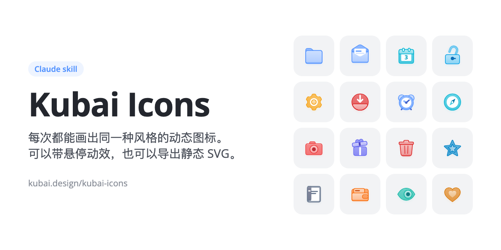
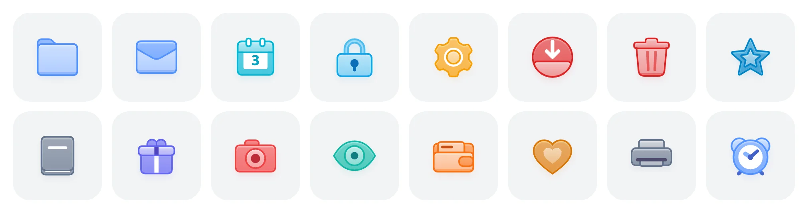
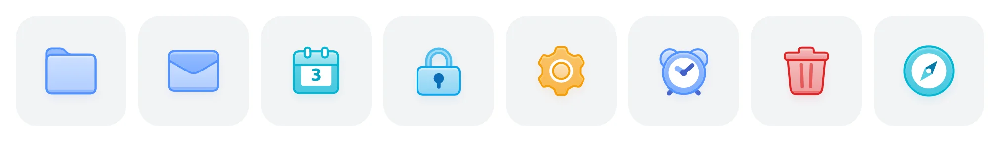
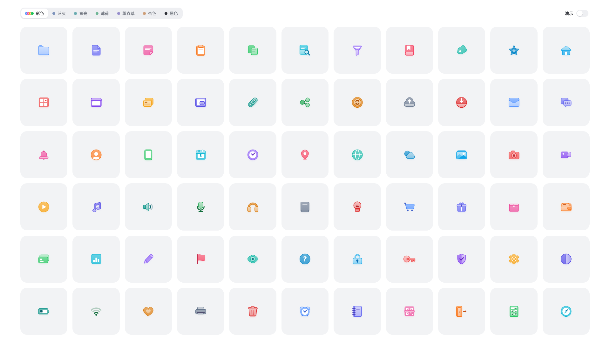

<p align="center">
  
</p>

<p align="center">
  文件夹式的前后分层，外描边，一个主色定全部颜色，
  悬停时做物体本来就会做的动作。不需要动效时，也能导出静态 SVG。
</p>

<p align="center">
  <a href="https://www.kubai.design/kubai-icons/">在线预览</a> ·
  <a href="#安装">安装</a> ·
  <a href="PROMPT.md">设计规则</a> ·
  <a href="SKILL.md">Skill 说明</a>
  <br />
  <a href="README.zh-CN.md">简体中文</a> |
  <a href="README.md">English</a>
</p>

<p align="center">
  
</p>

## 它能做什么

把功能清单或产品代码交给 Claude，它画出的新图标和仓库里这 66 个放在一起，看不出是两个人画的。要动效就交付带悬停形变的版本，不要就导出静态 SVG。

风格之所以稳，是因为难的部分都已经做好了，模型只管想清楚画什么、把形状画出来：

| 文件 | 负责什么 |
| --- | --- |
| [`PROMPT.md`](PROMPT.md) | 设计规则，条条都是硬性要求：画布与 keyline、分层、圆角与描边、光影、颜色、标记、动效。 |
| [`src/engine.js`](src/engine.js) | 引擎。颜色推导、外描边、渐变、投影、动画插值、色板全部现成，新图标直接用。 |
| [`src/icons.js`](src/icons.js) | 66 个范例。画新图标前，先找结构最像的那个照着写。 |
| [`scripts/check.mjs`](scripts/check.mjs) | 自检。在后台截出静止、悬停、悬停过程、24px、28px 和全部色板，模型对着截图逐条检查，改到全部过关为止。 |

## 盲测作品

<p align="center">
  
</p>

闹钟、笔记本、扫码、退出、计算器、指南针，这六个是一个全新的 Claude 会话画的，事先只给了它 `SKILL.md` 和 `PROMPT.md`。每做一轮盲测，就把它卡住的地方补进规则，下一批画出来就更像一家人。

## 安装

### 让 Claude 帮你装

把下面这段话复制给 Claude Code，发出去就行：

```text
帮我安装 Kubai Icons skill：
把 https://github.com/kubai087/kubai-icons 克隆到 ~/.claude/skills/kubai-icons，
已经装过的话就拉取最新版本；
确认 ~/.claude/skills/kubai-icons/SKILL.md 存在，装好后告诉我。
```

装好后重启 Claude Code，就可以用了。

### 自己动手装

从[最新 release](https://github.com/kubai087/kubai-icons/releases/latest) 下载 `kubai-icons-v*.zip`，解压到 skills 目录：

```bash
unzip kubai-icons-v1.0.0.zip -d ~/.claude/skills/
```

或者直接克隆仓库：

```bash
git clone https://github.com/kubai087/kubai-icons.git ~/.claude/skills/kubai-icons
```

两种方式都一样，重启 Claude Code 就会自动加载。

如果要上传到要求在 `SKILL.md` 里填版本号和展示名的 skill 市场，请用同一个 release 里的 `kubai-icons-v*-platform.zip`，这些字段已经放在 frontmatter 最外层了。

### 推荐用 Claude Opus 5.5

画这套图标要算准几何、照顾好每一帧的前后遮挡，还要反复看截图自己返工。这个 skill 就是用 **Claude Opus 5.5** 开发和盲测的，换它效果最稳。在客户端的模型列表里选它，或者这样启动 Claude Code：

```bash
claude --model claude-opus-5-5
```

### 怎么用

像平时说话一样提需求就行，说到图标它会自己调用这个 skill，不用特意点名：

- "看一下这个仓库，给主要功能画一套动态图标。"
- "在这套图标里加一个剪刀、一个地图。"
- "帮我画个「导出」图标，和其他的保持一致。"

### 它会怎么做

1. 先读 `PROMPT.md`，给每个功能定一个日常物体和它的悬停动作，比如"文件夹打开""锁弹开"。
2. 找结构最像的现有图标当底子，用引擎把新图标画出来。
3. 跑自检，把新图标和几个老图标摆在一起，比大小、描边、层次和颜色，不过关就接着改。
4. 把新图标放进展示页，顺手更新数量。

如果是给你的产品从头做一套，它会把引擎、展示页和自检脚本复制到你的项目里，在那边动手。

## 动态版和静态版

跟 Claude 说清楚要哪种；没说的话，它会先问你。

| | 动态版（默认） | 静态版 |
| --- | --- | --- |
| 拿到的是 | 悬停会形变的 SVG + JS，由引擎驱动 | 一个图标一个 `.svg` 文件，不带脚本和样式表 |
| 适合用在 | 网页，或任何能跑 JavaScript 的界面 | 设计工具、原生 App、文档、`` 标签 |
| 动效 | 每个部件两组关键帧：静止、悬停 | 没有，可以选静止或悬停结束时的样子 |

只要说"给我静态 SVG"或者"要能直接拖进 Figma 的"，它就会照常画好，再导出成文件。仓库里现成的图标，你也可以自己导：

```bash
node scripts/export.mjs --only 文件夹,日历 --palette 薄荷 --out icons/
```

| 参数 | 说明 |
| --- | --- |
| `--palette` | 色板：彩色（默认）、蓝灰、青瓷、薄荷、薰衣草、杏色、黑色。 |
| `--accent #hex` | 所有图标统一用这个主色。 |
| `--state hover` | 导出悬停结束时的样子，默认是静止状态。 |
| `--size 96` | 宽高，单位是像素。 |
| `--pad 2.5` | 四周留白，单位同图标坐标，免得投影被裁掉。 |
| `--out dir` | 输出目录，默认 `export/`。 |

## 构造原理

每个图标都是后片、前片，中间可以夹一层白色内容，就像文件夹里夹着一张纸。描边画在填充外面，形状不会因此变小。渐变、描边、投影的颜色全部由一个主色推出来，换一个色值整个图标跟着换。每个部件只有静止和悬停两组关键帧，动作都是物体本身的：文件夹打开，信封拆开，日历翻到第二天。

<p align="center">
  
</p>

内置七个色板：一个图标一种颜色的彩色；从一个基色推出来的五种清透色，分别是蓝灰、青瓷、薄荷、薰衣草、杏色；还有黑色。切换色板时，颜色也是渐变过去的。

## 在线预览

<p align="center">
  <a href="https://www.kubai.design/kubai-icons/"></a>
</p>

在 [www.kubai.design/kubai-icons](https://www.kubai.design/kubai-icons/) 可以看到整套图标：鼠标移上去看动效，切换色板，或者打开「演示」让它们一起动起来。本地直接用浏览器打开 `index.html` 也行。

## 自检

需要 Node.js 18 以上和 Chrome。全程在后台运行，不会弹出浏览器窗口。

```bash
node scripts/check.mjs --only 剪刀,地图 --with 文件夹,邮件,下载
```

| 参数 | 说明 |
| --- | --- |
| `--only` | 只查这几个图标；不加就查整套。 |
| `--with` | 拉几个现有图标放旁边对比。 |
| `--accent #F59E0B` | 所有图标换成同一个浅主色，看标记还清不清楚。 |
| `--scale 3` | 截图放大 3 倍，方便找细缝。 |
| `--out dir` | 截图存到别的目录，默认是 `check-out/`。 |

浏览器路径可以用环境变量 `CHROME` 指定。这份 README 里的动图是 `node scripts/media.mjs` 生成的，还需要装 `ffmpeg` 和 `img2webp`。

## 参与共建

欢迎两种贡献：

- **一起打磨 skill。** 哪条规则让你拿不准，就告诉我们；也可以开一个全新的会话做盲测，或者直接修脚本。改规则请先开 issue。
- **投稿你设计的图标。** 用这个 skill 画好图标，提一个 PR。合并后会收进展示页，鼠标移上去能看到你的名字。

具体要求见 [CONTRIBUTING.md](CONTRIBUTING.md)，也请看一下[行为准则](CODE_OF_CONDUCT.md)。安全问题请按 [SECURITY.md](SECURITY.md) 私下反馈。

## 授权

本仓库使用 [Kubai Icons License](LICENSE)。源码公开可见，但它不是开源协议。简单说：

- **你画的图标归你。** 用这个 skill 画出来的图标是你的，商用也可以，不用署名。
- **可以连同引擎一起发布。** 引擎、展示页、范例图标和自检脚本可以放进你自己的图标项目，按需修改后发布，只要保留每个文件开头的版权声明。
- **范例图标也可以用。** 这 66 个图标可以用在你的产品里，动态的、导出的 SVG 都行，不用署名；但不能单独打包成图标集或图标包发布。
- **skill 可以随便用、随便转。** 什么项目都能用，可以为自己改，也可以免费转发原封不动的副本。
- **别改了名字再发出去。** 不能发布改过或翻译过的规则（`PROMPT.md`、`SKILL.md`），不能拿这个 skill 卖钱，不能删掉版权声明，也不能换个名字说成是自己做的。

Kubai 和 Lumno 的名称、标志不在授权范围内。这套构造源自 [Lumno](https://github.com/kubai087/lumno-extension) 的书签文件夹图标。
